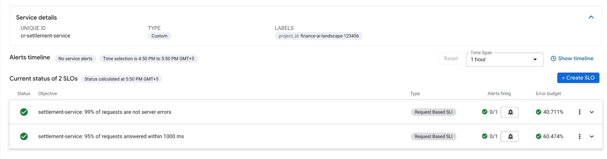

# Evidence from the running cloud

Dated captures from the real free-tier Google Cloud project (GCP-02). Each entry says what it shows and how to read it; nothing here is staged: the numbers are what the console displayed.

## 27 November 2026: service level objectives on settlement-service

Cloud Monitoring, Services, `cr-settlement-service`: two SLOs created by Terraform (`landscape/observability`) from Cloud Run's own request metrics, with a fast-burn alert on each, none firing.

| SLO | Error budget left |
|---|---|
| 99% of requests are not server errors (28 days) | 40.7% |
| 95% of requests answered within 1000 ms (28 days) | 60.5% |

How to read it. The budget that is already spent comes from the ledger-database outage of drill 1 the same afternoon (`DRILL_RESULTS.md`): requests failed or waited for the 30-second connection timeout, counting both as errors and as slow. This landscape sees little traffic (a scenario run is a few dozen requests), so a short outage is a visible share of 28 days; the percentages swing a lot on a handful of requests and should not be over-read. As normal traffic passes, the budget recovers: a second capture some days later shows that.

What it shows about the practice: reliability is stated as an objective with a measurable budget, built as code on metrics that cost nothing, and a deliberate failure is visible in it.

## 27 November 2026: an approval survives a redeploy (drill 4)

A proposal was made at 13:32 UTC on revision `genai-assistant-service-00018-nww`; the assistant was redeployed to `00019-h48` while it waited; about 12 minutes later a second person approved it on the new revision. The write-off (adjustment `fac0744b-…`) was posted once and read back from the ledger, the reconciliation exception `BANK-ffe4a6-2` was RESOLVED, and the replay of the same approval was refused. Run `scenario-ffe4a6`; steps and numbers in `DRILL_RESULTS.md`.

What it shows about the practice: state that a human decision depends on is kept outside the service, so a release in the middle of an approval is routine; and the claim is proven both in CI (a second instance on the same state) and on the real cloud.
