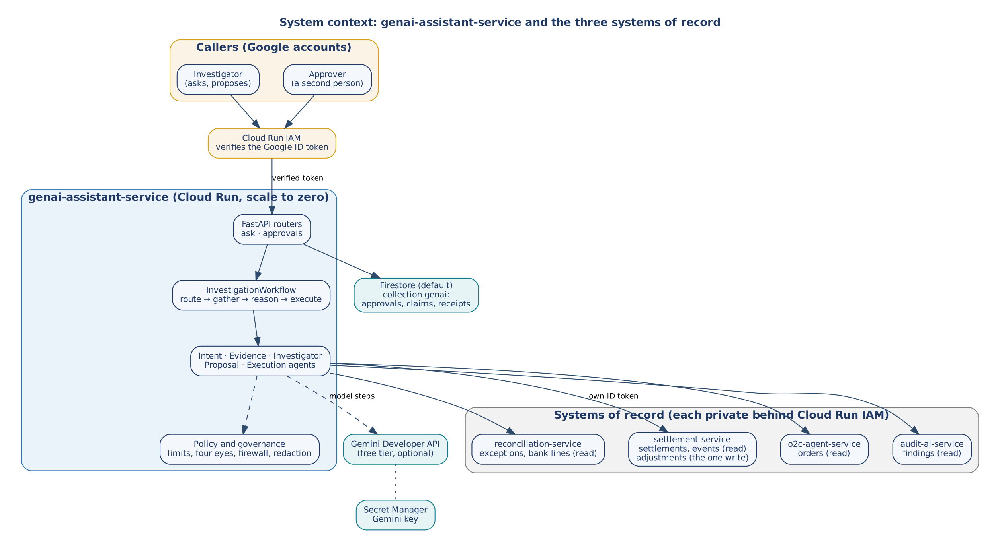
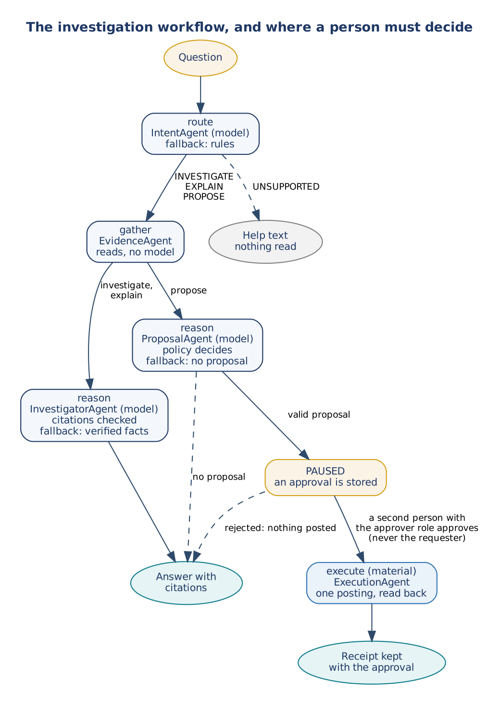
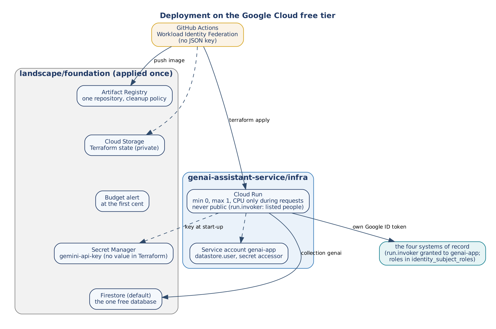

# Enterprise Finance GenAI Assistant — Design

### High-Level and Low-Level Design

*This document describes `genai-assistant-service`, a finance investigator over the Order-to-Cash landscape. It answers why a payment is unmatched or a settlement is delayed or flagged from the systems of record, with citations; it proposes a write-off or refund within policy; and it executes an adjustment only after a second person approves, exactly once. Models draft and explain; policy, identity and a person decide; deterministic code acts. The document covers the design from the requirements down to class contracts, as the code on `main` implements it, and runs on the Google Cloud free tier. It follows the structure of the Order-to-Cash design document and refers to the E2A, A2C and e2a-managed-providers documents rather than repeating them.*

| | |
|---|---|
| Project | `enterprise-finance-genai-assistant` — service `genai-assistant-service` |
| Document type | Design Document (HLD + LLD) |
| Author | Subham Gupta, Principal Platform Architect |
| Source baseline | `subhamviky/enterprise-finance-genai-assistant` `main` at `873bd7a`:<ul><li>**genai-assistant-service:** Python 3.12, FastAPI, 1,733 lines in 26 modules; `policies/`, `evals/`; 66 tests in 9 modules.</li><li>**Built on:** **E2A v1.11.0** and **e2a-adapters 1.11.0** `[gcp]`; optional **e2a-managed-providers v0.2.0** `[gemini-api]`. Generated by **A2C v1.6.0** `aidlc-build`; the untouched scaffold is the branch `aidlc/genai-assistant-service`.</li><li>**Infrastructure:** `genai-assistant-service/infra` (4 Terraform tests), `landscape/foundation` (2 Terraform tests), `deploy/gcp/*.vars`, `.github/workflows/landscape-gcp.yml`.</li></ul> |
| Date | 25 November 2026 |
| Status | Describes the code on `main`. Section 14 lists where the code and the plan differ, and the open gaps. |

> **Reference implementation, not a production service.** It runs on synthetic data (tenant `acme`) and must not be pointed at real customer or payment data. Product names (Google Cloud, Cloud Run, Firestore, Pub/Sub, Secret Manager, Artifact Registry, Gemini and others) are trademarks of their owners and are used only to describe the design.

## 1. Introduction

### 1.1 Purpose

A finance investigator that talks to three systems can cause harm in three ways: by stating something no record supports, by acting on a record it should not read, and by moving money on a model's say-so. This document is the design reference for the service that prevents all three:
- the requirements (Sections 2 and 3) and principles (Section 4);
- the high-level design: context, framework use, components, deployment, integration and identity (Section 5);
- the data design (Section 6) and the low-level design: modules, classes and contracts (Sections 7 and 8);
- dynamic behaviour (Section 9), consistency and failures (Section 10);
- non-functional design (Section 11), configuration (Section 12), verification (Section 13), and gaps (Section 14).

### 1.2 Audience

| Reader | Read |
|---|---|
| Architects, reviewers, recruiters | Sections 2, 4, 5, 10, 13 and 14 |
| Engineers | Sections 6 to 10 and 12 |
| Operations | Sections 5.4, 10, 11 and 12, and `docs/RUNBOOK.md` |

### 1.3 Status labels

| Label | Meaning |
|---|---|
| **Implemented** | In the code on `main`, with tests that CI runs |
| **Configured** | Implemented, and active only when its setting is given |
| **Gap** | Not done, or done differently from the plan (Section 14) |

### 1.4 Related documents

| Document | Where | Used for |
|---|---|---|
| The landscape plan | the private hub, `roadmap/design/GCP-01-free-tier-landscape.md` | Decisions D1 to D9, free-tier limits, the end-to-end scenario, the cutover |
| E2A framework | `e2a-framework/docs/design/` | `BaseAgent`, `BaseWorkflow` and `resume()`, governance stages, tools, idempotency claims, evaluation, identity at ingress |
| A2C | `a2c-framework/docs/design/` | `aidlc-build`, the generated scaffold, release gate and evaluation sets |
| e2a-managed-providers | `e2a-managed-providers/docs/design/` | The `gemini_api` profile |
| The three systems | `payment-reconciliation-engine`, `financial-settlement-platform`, `order-to-cash-agentic-ai` | The contracts this service consumes |
| Evaluation report and runbook | `docs/EVALUATION_REPORT.md`, `docs/RUNBOOK.md` | Results, and the cutover and operations |

## 2. Problem and Requirements

### 2.1 The problem

Investigating a payment means reading a reconciliation exception, the bank line, the settlement and its events, the order and the audit findings: five records in four systems. An assistant can do the reading and the phrasing. It must not invent a record, must not act for a tenant or a role it was not granted, and must not post to a ledger without a decision by a second person.

### 2.2 Requirements traced to the design

| Requirement (from the plan, Section 6) | Where it is met |
|---|---|
| Investigate an unmatched payment: exception, bank line, settlement event, order, policy evidence; read-only, cited | `EvidenceAgent` and `InvestigatorAgent` (Sections 8.1, 9.1); citations checked against what was read |
| Explain a delayed or flagged settlement, separating verified from inferred | the answer schema has `verified` and `inferred`; the grounding check applies to `verified` |
| Propose a write-off or refund: the model drafts, policy and risk validate, a person approves | `ProposalAgent`, `Policy.check_proposal`, the approval stage and `resume()` (Sections 8.1, 9.2) |
| Execute an approved adjustment: idempotent, read back, receipt kept | `ExecutionAgent` and `PostAdjustment` (Sections 8.2, 9.2) |
| Gemini behind a provider boundary; timeouts, retries, token accounting, validated JSON; model name in configuration; metadata logged, not prompts | the model comes from `E2A_PROVIDER_PROFILE` (`gemini_api`, `LLM_MODEL_ID`); E2A's call policy; every agent validates its model output against a schema |
| Least-privilege tools, arguments validated at execution, not by the prompt | the tool allow-list per agent (`policies/governance.yaml`); `HttpJsonTool._validate_input` |
| A deterministic fallback when the model is down; never bypass approval | the `_fallback` and `_handle_error` of the three model agents; the material step needs an approval regardless of the model |
| Rate limits, redaction, bounded retries; prompt-injection tests | capacity and token-budget stages, firewall and redaction stages; `evals/redteam.json` |
| 50 to 100 synthetic evaluation cases; task success, groundedness, tool-call precision, unauthorised actions, latency, tokens | 53 golden and 9 red-team cases scored by the release gate (Section 13); report in `docs/EVALUATION_REPORT.md` |
| Persisted run state, tool receipts, audit metadata | Firestore collection `genai`: approvals, checkpoints, claims, receipts (Section 6) |
| CI: tests, lint, security scan, image build, Terraform validation; deploy through OIDC | `genai-assistant-service-ci.yml`, `-a2c-ci.yml` (image scan; deploy switched off until the cutover); `landscape-gcp.yml` |
| Security checklist | Section 5.6 and `SECURITY.md` |
| Failure-injection matrix | Section 10.2: one test per row |
| Documents; integrated scenario | this document, the runbook, the evaluation report; Section 13.4 |

### 2.3 Constraints

| Constraint | Consequence |
|---|---|
| Free tier only, never a paid plan (D1) | Always Free regions, one Cloud Run instance, no paid AI service; Terraform refuses other regions and models |
| One free Firestore database per project (D3) | state in collection `genai` of the shared `(default)` database |
| Gemini Developer API free tier: about 8 requests per minute and 200 per day (D5) | a request makes at most three model calls; the gemini_api profile enforces the limits in-process; the deterministic fallbacks keep the service useful when the quota is spent |
| No UI (D6) | an HTTP API behind Cloud Run IAM, called with an ID token |

## 3. Use Cases and Non-goals

### 3.1 Actors

| Actor | Role in the system | Can |
|---|---|---|
| Investigator | `investigator` | ask, explain, propose |
| Approver | `finance-approver` | approve or reject a proposal made by someone else |
| The assistant | service account `genai-app` | read the four systems; post one kind of adjustment, only after an approval |

### 3.2 Use cases

| Use case | Request | Outcome |
|---|---|---|
| UC-1 Investigate | "Why is bank line L-1001 unmatched?" | answer with citations; nothing written |
| UC-2 Explain | "Why was settlement S flagged?" or an order id | answer, `verified` and `inferred` separated |
| UC-3 Propose | "Propose a write-off for bank line L-1001" | a proposal waiting for approval, or a stated refusal |
| UC-4 Approve or reject | `POST /api/v1/approvals/{id}/approve` or `/reject` | one posting with read-back and receipt, or nothing |
| UC-5 Unsupported or unknown | anything without an identifier, or an unknown one | help text, or `NOT_FOUND`; no guess |

### 3.3 Non-goals

No user interface; no real money or real customer data; no autonomous execution; no long-term memory across requests; no model fine-tuning; no paid cloud service.

## 4. Design Principles and Invariants

### 4.1 Principles

| Principle | Where it shows |
|---|---|
| The model drafts; policy and a person decide | `ProposalAgent` output goes through `Policy.check_proposal` and an approval before `ExecutionAgent` exists in the run |
| Every claim is a record that was read | evidence items carry identifiers; an answer citing another identifier, or stating an amount or id no record contains, is refused |
| Fail safe | each model step has a deterministic fallback; the proposal fallback is "no proposal" |
| The tenant and the caller come from verified identity, never from the model or the request body | `routers/identity.py`; tools take the tenant from the request context |
| Material effects are idempotent and read back | the idempotency key end to end; `post_adjustment` is followed by a ledger read |
| Least privilege everywhere | tool allow-lists per agent; one service account per service; each system checks the caller itself |

### 4.2 Invariants

| # | Invariant | Enforced by | Tested by |
|---|---|---|---|
| I1 | An adjustment is posted at most once | idempotency key from the proposal's content; settlement-service de-duplicates on it; `resume()` decides a checkpoint once | `test_a_replayed_approval_posts_nothing_twice`, `test_concurrent_approvals_post_once` |
| I2 | Nothing is posted without a valid proposal and an approval | `ApprovalStage`; `ExecutionAgent` runs only after `resume()` | `test_propose_then_a_second_person_approves_and_it_posts_once`, evaluation `approve-*` |
| I3 | The requester never approves their own proposal; only the approver role decides | `InvestigationWorkflow._authorize_decision` | `test_the_requester_cannot_approve_their_own_adjustment`, `test_only_an_approver_may_decide` |
| I4 | A proposal outside policy is never offered | `Policy.check_proposal` | `test_a_proposal_above_the_policy_limit_is_never_offered`, `test_policy_checks_every_drafted_proposal` |
| I5 | An answer cites only records it read | `InvestigatorAgent._evaluate_output` | `test_an_answer_with_invented_citations_is_refused` |
| I6 | One tenant never reads or decides another's data | tenant from identity; approvals and receipts keyed by tenant | `test_a_cross_tenant_request_reads_nothing`, `test_another_tenant_cannot_see_or_decide_an_approval` |
| I7 | A prompt injection causes no action | firewall stage; the model's prompt gate; no tool on the model steps | `test_an_injection_in_the_request_is_refused_before_any_read`, `evals/redteam.json` |

## 5. High-Level Design

### 5.1 System context

The assistant sits in front of four services that already existed: reconciliation, settlement, order-to-cash and audit. It is a client of them: each stays the system of record and checks the caller, the tenant and the action itself. The assistant adds no data of its own beyond approvals, claims and receipts.

### 5.2 How the framework family is used

| Concern | Used from | How |
|---|---|---|
| Agent lifecycle, NFRs | E2A `BaseAgent` | five agents with the generated hook contract (`_prepare`, `_build_messages`, `_evaluate_output`, `_fallback`, `_act`, `_handle_error`) |
| Steps, approval, resume | E2A `BaseWorkflow` (`Steps`, `Route`, `Step(material=True)`, `resume()`) | `InvestigationWorkflow`; a paused step is a checkpoint |
| Governance | E2A stages | capacity, token budget, firewall, entitlement, approval, redaction (Section 8.3) |
| Tools | E2A `RestToolService` | `HttpJsonTool`, `PostAdjustment`; typed outcomes COMMITTED, NOT_COMMITTED, UNKNOWN |
| State | e2a-adapters `[gcp]` | Firestore transactional and idempotency stores |
| Identity | e2a-adapters `ingress` (`gcp_cloud_run`) and `workload` (`gcp_id_token`) | inbound and outbound ID tokens (E2A v1.11.0) |
| Model | E2A `bindings_from_profile` | `simulated` or `gemini_api` through `E2A_PROVIDER_PROFILE` |
| Evaluation and release | E2A `ProjectReleaseGate`, `e2a.evals` | generated by A2C, `_run_case` written by hand |

### 5.3 Logical architecture

| Step | Agent | Kind | Reads or writes | Fallback |
|---|---|---|---|---|
| route | `IntentAgent` | model | nothing; classifies the request and extracts identifiers the request itself states | rules over the text |
| gather | `EvidenceAgent` | deterministic | exception, bank line, order, settlements, settlement events, audit findings (read tools only) | a gap is recorded, never guessed |
| reason | `InvestigatorAgent` | model | nothing | the verified facts alone, each with its identifier |
| reason | `ProposalAgent` | model | nothing | action NONE, with the reason |
| execute | `ExecutionAgent` | deterministic, material | re-reads the settlement; posts the adjustment; reads the ledger back | none: an unknown outcome is not retried blindly |

### 5.4 Deployment on Google Cloud

| Component | Free-tier shape |
|---|---|
| Compute | Cloud Run, minimum 0, maximum 1 instance, CPU only during requests, 512 MiB, never public |
| State | the project's one free Firestore database, collection `genai` |
| Images | one Artifact Registry repository for the landscape, a cleanup policy keeping it within the free 0.5 GB |
| Model | Gemini Developer API (free key in Secret Manager) or the simulated model |
| Deployment | GitHub Actions through Workload Identity Federation, limited to the owner's four repositories; no JSON key exists |
| Cost control | a budget alert at the first cent (₹1 in the trial's billing currency); Terraform refuses non-free regions and models |

*Deployed (status: verified, 25 November 2026).* Project in `us-central1`; the assistant is the Cloud Run service `genai-assistant-service` (service account `genai-app`), callable by the two people and the two scenario accounts only. The four systems run beside it in the same project: settlement (Cloud Run, with its PostgreSQL ledger on an e2-micro Container-Optimized OS VM with no external address), reconciliation and audit-ai (Cloud Run, Pub/Sub push with a dead-letter topic), O2C (Cloud Run). Every service scales to zero and uses CPU only during requests; the model calls are bounded (12 seconds, one retry). The billing report for 1 to 25 November shows ₹0.00 against ₹28,569.00 of trial credit.

### 5.5 Integration and contracts

| System | Endpoint | Tool | Role the assistant needs |
|---|---|---|---|
| reconciliation-service | `GET /service/v1/exceptions`, `GET /service/v1/lines/{id}` | `get_reconciliation_exception`, `get_bank_line` | `reconciliation.read` |
| settlement-service | `GET /api/v1/settlements/{id}`, `GET /api/v1/events`, `POST` and `GET /api/v1/settlements/{id}/adjustments` | `get_settlement`, `get_settlement_events`, `post_adjustment` | `settlement.read`, `settlement.adjust` |
| o2c-agent-service | `GET /api/v1/orders/{id}` | `get_order` | read |
| audit-ai-service | `GET /audits/{settlement_id}` | `get_audit_findings` | read |

Every call carries `X-Tenant-Id` and, when configured, the service's own Google ID token. The audience is the target's URL, which is what Cloud Run IAM checks.

### 5.6 Identity and security

| Layer | Mechanism |
|---|---|
| Who may reach the service | Cloud Run IAM: `roles/run.invoker` for the listed people only; Terraform refuses `allUsers` and `allAuthenticatedUsers` |
| Who the caller is | the verified Google ID token's email (E2A `gcp_cloud_run`; both issuer spellings are trusted, `accounts.google.com` for a person's token and `https://accounts.google.com` for a service account's; a token without an email is not matched to any grant); the deployment grants each caller its tenants (`tenant:<id>`) and roles (`identity_subject_roles`); the caller names its tenant in `X-Tenant-Id` and may choose its acting role in `X-User-Role` among the roles it holds |
| What an agent may call | the tool allow-list of each agent (`policies/governance.yaml`), applied by E2A to `io_read` and `io_modify` |
| What the assistant may do in the systems | the roles granted to its service account in each system, checked there |
| Secrets | the Gemini key is a Secret Manager reference; nothing secret is in the repository, the Terraform state or the logs |
| Personal data | IBANs, card numbers and e-mail addresses are masked on the way out |

### 5.7 Model access

The model is reached only through `config['llm_service']`, bound from `E2A_PROVIDER_PROFILE`. The `simulated` profile (the default) answers with the rules in `services/simulated.py`, so CI and local runs need no account. The `gemini_api` profile adds the Gemini client (`poetry install --extras gemini`, or the image built with `POETRY_EXTRAS=gemini`) and E2A's per-minute and per-day limits. The agents' checks are the same for both: a model answer is accepted only if it passes them. Live findings shaped three rules: the model's JSON is read from inside a markdown code fence or a sentence, because Gemini wraps it; an unreadable *intent* reply is read with the rules and the investigation continues (a model fallback ends a workflow, which would turn a valid request into "no record was found"); and each model call is bounded (`LLM_SDK_TIMEOUT` 12 seconds, `LLM_SDK_MAX_RETRIES` 1), so a busy free-tier model degrades the answer to the verified facts instead of making the caller wait a minute. The answer lists `records_read`, the records the evidence step read, next to the `citations` the model chose among them.

## 6. Data Design

| Record | Key | Content | Written by |
|---|---|---|---|
| Approval and checkpoint | `approval:<id>` | the approval (tenant, requester, status, proposal, query, citations, decider) and the paused workflow state | `ApprovalStore.save`; `decide` is one compare-and-set |
| Approval index | `approvals:<tenant>` | the tenant's newest 500 approval ids | `ApprovalStore._index`, compare-and-set |
| Receipt | `receipt:<tenant>:<id>` | outcome, status, adjustment id, whether the ledger showed it, approver, idempotency key | `ApprovalStore.record_receipt`, written once |
| Idempotency claim | E2A's claim record | the key, its state and result | E2A `BaseWorkflow` |

The records live in the transactional store behind `state_ports()`: in memory (`GENAI_STATE_BACKEND=memory`, tests and local runs) or Firestore (`firestore`, collection `GENAI_FIRESTORE_COLLECTION`, default `genai`). The data is synthetic.

## 7. Low-Level Design — Module Structure

| Package | Modules | Responsibility |
|---|---|---|
| `agents/` | `intent_agent`, `evidence_agent`, `investigator_agent`, `proposal_agent`, `execution_agent` and the generated `*_output` models | the five agents |
| `workflow/` | `investigation_workflow` | steps, idempotency key, who may decide |
| `services/` | `assistant` (composition root), `policy`, `governance`, `validation`, `evidence`, `stores`, `state`, `bindings`, `simulated` | the capabilities and their data |
| `tools/` | `catalog` | the six HTTP tools |
| `routers/` | `api`, `identity` | HTTP and the caller |
| `release/` | `gate` | the release gate's `_run_case` |
| `standins/` | `landscape` | in-memory stand-ins of the four systems |

## 8. Low-Level Design — Class Contracts

### 8.1 Agents and workflow

| Class | Contract |
|---|---|
| `IntentAgent` | model output must match `IntentAgentOutput`; a returned identifier is kept only if the request contains it; an intent without an identifier becomes UNSUPPORTED; on a model error or invalid answer, `rule_intent` classifies (degraded) |
| `EvidenceAgent` | `_prepare` reads through `io_read` only; each fact becomes an evidence item `kind:key` (`recon`, `line`, `order`, `settlement`, `event`, `audit`); up to three settlements are followed; a system that does not answer is a gap; the line item states the difference to the nearest open item, computed from the two records |
| `InvestigatorAgent` | accepted only if the JSON matches `InvestigatorAgentOutput`, at least one citation is given, every citation is an evidence id, and every id, amount and status word in the answer or `verified` occurs in the evidence the model saw; otherwise the fallback answers with the facts |
| `ProposalAgent` | accepted only if the JSON matches `ProposalAgentOutput` and `Policy.check_proposal` returns no reason; the fallback is action NONE |
| `ExecutionAgent` | `_prepare` re-reads the settlement; `_act` posts only if it is still COMPLETED, with the workflow's idempotency key; the receipt is kept in the state |
| `InvestigationWorkflow` | steps route, gather, reason (by intent), execute (when the proposal is actionable, material); the idempotency claim is taken only for an actionable proposal; the key is a hash of tenant, user and proposal; `_authorize_decision` requires the approver role and, with four eyes, a decider other than the requester |

### 8.2 Tools

| Class | Contract |
|---|---|
| `HttpJsonTool` | one endpoint; `_validate_input` requires every field and refuses path arguments holding `/ ? # % \` or over 100 characters; a status of 500 or more raises (the resilience policy may retry a read); other statuses become a typed outcome |
| `PostAdjustment` | the one material tool; success is 200 or 201; a 409 while the key is in progress is not definitive (UNKNOWN); after success the adjustments are listed and the posted one must be in the list (`read_back`) |

### 8.3 Policy and governance

`Policy` parses `policies/governance.yaml`: entitlements per agent, tool allow-lists, adjustment limits (WRITE_OFF 250.00, REFUND 1,000.00), the approver role and four eyes, firewall patterns and length, redaction rules, capacity and token budget. `check_proposal` refuses an unknown action, a settlement not in the evidence or not COMPLETED, an amount that is not a positive two-decimal number, above the limit or above the settlement amount, a currency that differs, and a missing reason. `ServiceGovernance` builds the stages from it on every request.

### 8.4 HTTP API

| Route | Role | Result |
|---|---|---|
| `POST /api/v1/ask` | investigator or approver | the answer, or an approval waiting |
| `GET /api/v1/approvals`, `GET /api/v1/approvals/{id}` | the tenant's callers | approvals; the receipt with the approval |
| `POST /api/v1/approvals/{id}/approve`, `/reject` | `finance-approver`, not the requester | the receipt, or the rejection |
| `GET /health` | none | liveness |

Refusals are typed: 401 without a verified token, 403 for an ungranted tenant, role or decider, 404 for an unknown approval, 503 when capacity is exhausted.

## 9. Dynamic Behaviour

### 9.1 Investigating

The request passes validation and the governance stages; `IntentAgent` names the line, settlement or order; `EvidenceAgent` reads the exception and the bank line, follows the candidate settlements, reads their events and audit findings, and notes what it could not read; `InvestigatorAgent` writes the answer; the checks accept it or the fallback answers with the facts. Nothing is written.

### 9.2 Proposing, approving and posting

`ProposalAgent` drafts; policy accepts or refuses. An accepted proposal reaches the approval stage, which pauses the workflow: the checkpoint and the approval are stored and the caller gets the approval id. A second person with the approver role calls approve; E2A `resume()` loads the checkpoint, `_authorize_decision` checks the decider, the decision is recorded as one compare-and-set, and `ExecutionAgent` runs under the claim: it re-reads the settlement, posts the adjustment with the idempotency key, and reads the ledger back. The receipt is stored. A repeat of the same request, or of the approval, posts nothing: the claim and the decided checkpoint answer it.

### 9.3 States of an approval

PENDING, then APPROVED or REJECTED, once. A concurrent second decision is refused.

## 10. Consistency, Concurrency and Failures

### 10.1 Consistency

The decision on an approval is one compare-and-set; the claim is held across the material step; settlement-service de-duplicates the posting on the key. A crash after the post and before the receipt leaves a posted adjustment whose retry returns the first result.

### 10.2 The failure-injection matrix (each row is a test)

| Failure | Behaviour | Test |
|---|---|---|
| Gemini 429 or timeout: investigation | verified facts alone, degraded | `test_model_down_investigation_degrades_to_the_verified_facts` |
| Gemini down: proposal | no proposal, nothing posted | `test_model_down_never_proposes_and_never_posts` |
| Model invents a citation | refused; the facts answer | `test_an_answer_with_invented_citations_is_refused` |
| settlement-service gives no answer to the post | UNKNOWN, nothing recorded as posted, a retry posts once | `test_unknown_settlement_answer_is_unknown_and_the_retry_posts_once` |
| Approval replayed | refused | `test_a_replayed_approval_posts_nothing_twice` |
| Four concurrent approvals | one posts | `test_concurrent_approvals_post_once` |
| Requester approves | refused | `test_the_requester_cannot_approve_their_own_adjustment` |
| Wrong role approves | refused | `test_only_an_approver_may_decide` |
| Another tenant | reads and decides nothing | `test_another_tenant_cannot_see_or_decide_an_approval`, `test_a_cross_tenant_request_reads_nothing` |
| settlement-service refuses (its own limit) | NOT_COMMITTED, the receipt says so | `test_settlement_refuses_above_its_own_limit_and_the_receipt_says_so` |
| Settlement changed since the proposal | not adjusted | `test_a_settlement_that_changed_since_the_proposal_is_not_adjusted` |
| Rejected proposal | nothing posted | `test_a_rejected_proposal_posts_nothing` |
| Duplicate event | no second finding | scenario step 9b |
| Cold start; partial deploy | runbook: a Cloud Run revision rollback | `docs/RUNBOOK.md` (not a test) |

## 11. Non-functional Design

| Concern | Design |
|---|---|
| Cost | $0 at list price: free regions, one instance scaled to zero, free model tier; a budget alert at the first cent |
| Rate limits | at most three model calls per request; the gemini_api profile limits requests per minute and per day in-process; in-flight requests limited to 8 |
| Latency | no model on the evidence step (the four reads took about one second in total); the model steps dominate: in the first cloud run an investigation took 79 seconds and a proposal 24 on the free-tier model, and a step with no model call about one second; one run, so no percentiles (Section 14) |
| Observability | E2A's structured logs (metadata, not prompts) and the evaluation records; correlation ids per request |
| Availability | a model outage degrades answers and removes proposals; it never blocks reading or stops a decided approval |
| Data | synthetic; Firestore PITR and delete protection are off on the shared free database, which `terraform destroy` removes before the trial ends |

## 12. Configuration

| Variable | Meaning |
|---|---|
| `E2A_PROVIDER_PROFILE`, `LLM_MODEL_ID`, `GEMINI_API_KEY` | the model (simulated or gemini_api); the key comes from Secret Manager |
| `GENAI_STATE_BACKEND`, `GENAI_FIRESTORE_COLLECTION`, `FIRESTORE_DATABASE`, `GOOGLE_CLOUD_PROJECT` | where state lives |
| `E2A_IDENTITY_SOURCE=gcp_cloud_run`, `E2A_IDENTITY_TRUSTED_ISSUERS`, `E2A_IDENTITY_SUBJECT_ROLES` | who may call and what each may do |
| `E2A_WORKLOAD_IDENTITY=gcp_id_token` | the service's own token to the four systems |
| `RECONCILIATION_API_URL`, `SETTLEMENT_API_URL`, `O2C_API_URL`, `AUDIT_API_URL` | the four systems |
| `policies/governance.yaml` | limits, entitlements, firewall, redaction, capacity |

## 13. Verification

### 13.1 Tests

71 tests in 9 modules: the journeys; the failure matrix (17: with the fenced and unreadable model replies and the wording-independent claim); safety (8: injection, limits, invented identifiers, entitlements, redaction); the HTTP API with Cloud Run identity (4); the converter of the placeholder files (6); and the generated contract, conformance and workflow tests.

### 13.2 Evaluation sets

53 golden cases (investigation 8, explanation 12, orders 6, proposals 8, approvals 5, unsupported 4, unknown identifiers 3, outages 4, cross-tenant 3) and 9 red-team cases (6 injection, 3 personal data), scored by E2A's scorers (trajectory, refusal, contains and forbidden, no PII) in the release gate. Results and their limits are in `docs/EVALUATION_REPORT.md`.

### 13.3 CI

Tests; a second run with the state in the Firestore emulator; strict E2A conformance; the release gate and its report; Terraform fmt, validate and test for both stacks; the image build with a vulnerability scan. The `landscape-gcp` workflow runs the scenario.

### 13.4 The landscape scenario

`landscape/scenario.py` runs the plan's scenario against the five services in their Google Cloud configuration: an order, its event through Pub/Sub, an audit flag, a short payment, the assistant's cited explanation, a proposal, a second person's approval, one posting to a balanced ledger, replays, an injection and another tenant. It passes on the emulators in CI (Firestore, Pub/Sub, PostgreSQL), with the assistant behind Cloud Run-style identity, and it **passes against the deployed services** (target `cloud` of `landscape-gcp`, 25 November 2026, about 125 seconds): GitHub Actions authenticates through Workload Identity Federation, every call carries a Google ID token, and the two people are two stand-in service accounts. Step 7a (the requester approving their own proposal) runs only locally, where one identity can claim both roles. Each run uses its own orders, bank lines and amounts, so it can be repeated. Evidence and findings: `docs/EVALUATION_REPORT.md`.

## 14. Gaps and Deviations

| # | Gap or deviation | Effect | Follow-up |
|---|---|---|---|
| G-1 | The execution step posts to settlement-service's adjustment API directly, as reconciliation does, not through reconciliation | the exception stays open in reconciliation until its own accept | a service route to accept an exception |
| G-2 | One trace across the services is not implemented | correlation ids are per request, not carried on the tools' calls | carry the correlation id and add tracing |
| G-3 | The 62-case sets were written for the simulated model; run against `gemini-3.5-flash-lite` they score 0.943 (50 of 53 golden cases perfect, 9 of 9 red-team cases pass), the score before two fixes was 0.855 | three golden cases stay below 1.0: two expect the policy's limit, which the live model never reaches because it declines first; one posts after approval and met HTTP 429 (open) | rerun that case after the quota resets; keep the sets as wiring evidence (`docs/EVALUATION_REPORT.md`) |
| G-4 | Latency is measured for one cloud run, not as percentiles | p50 and p95 are unknown; cold start is inside the one run | repeat the scenario and read the request log |
| G-5 | *Closed.* Cloud-side identity is verified by Cloud Run IAM in the cloud | the cloud scenario exercises IAM's signature check, the issuer rule and the grants | none |
| G-6 | *Closed.* The cloud target of `landscape-gcp` ran and passed (25 November 2026) | | none |
| G-7 | Approvals are listed from an index of the newest 500 per tenant | older approvals stay readable by id but not listed | pagination if needed |
| G-8 | The free-tier model is sometimes busy (503) and slow | an investigation took 79 seconds in the one cloud run; answers degrade to the verified facts when a call fails | a paid or less loaded model is a change of `LLM_MODEL_ID`, not of code; the trial is not upgraded |
| G-9 | With real identities the self-approval case (step 7a) cannot be run by one stand-in account | covered locally and by tests (`DECIDER_REFUSED`); the cloud run covers an investigator's refusal and a second person's approval | a third stand-in account holding both roles |
